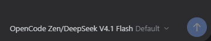

<p align="center">
  
</p>

<p align="center">
  <strong>English</strong> | <a href="https://github.com/ken95573/dsh-model-show/blob/main/README.zh-CN.md">简体中文</a>
</p>

<p align="center">
  <a href="https://www.npmjs.com/package/dsh-model-show"></a>
  <a href="https://www.npmjs.com/package/dsh-model-show"></a>
  <a href="https://github.com/ken95573/dsh-model-show/stargazers"></a>
  <a href="https://github.com/ken95573/dsh-model-show/blob/main/LICENSE"></a>
</p>

# dsh-model-show

The composer's model selector in DSH Web shows **Provider/Model** instead of a bare model name, so
the picked model always names the provider it came from — and nothing else about the selector
changes.

| | Composer trigger |
|---|---|
| Before | `Example Chat · High` |
| After | `Example Provider/Example Chat · High` |

*Above: provider `OpenCode Zen`, model `DeepSeek V4.1 Flash`; the trailing `Default` is the
thinking-effort suffix DSH already appends.*

- **Only the trigger text changes.** The provider prefix comes from your own model configuration
  (`displayName`) — no hard-coded vendor list.
- **Dropdown and search stay native.** Rows remain plain model names under their provider headings;
  typing a provider name still matches nothing.
- **The built-in release badge survives** (`DeepSeek-V4.1-Flash` → `1017`) and keeps following
  whatever the running DSH build ships.
- **Other plugins decorating the same label are rendered too**, each in its own bounded box behind
  an error boundary (v1.0.4).
- **No settings, no network, no telemetry.** It reads the catalog DSH already has.

## Requirements

- DSH `>= 0.2.1-rc.2 < 0.2.2`, `web` client platform.
- The built-in model selection plugin (`@deepseek-ai/dsh-client-ui-model-selection`) must stay
  enabled — this plugin reuses its `modelDirectories` service and only shadows the composer seat.
  The built-in label plugin (`…deepseek-model-label-1017`) must stay enabled too; it draws the badge.
- Provider names are whatever your configuration declares (`displayName`), e.g. `Example Provider`.

## Install

**Plugin market** — search the npm package name `dsh-model-show`, install, enable.

**Desktop CLI** (the reserved `desktop` profile is managed only by the app's own CLI):

```console
"%LOCALAPPDATA%\Programs\DeepSeek Harness\resources\runtime\cli\bin\dsh.cmd" plugin --profile desktop add dsh-model-show
```

From GitHub or a local directory, replace the package name with `github:<user>/dsh-model-show` or
`"C:\path\to\dsh-model-show"`. **Update** with an explicit version
(`add dsh-model-show@<version>` — see [releases](https://github.com/ken95573/dsh-model-show/releases); the registry `latest` can lag behind rc builds); **remove** with
`plugin --profile desktop remove dsh-model-show`.

**Let the agent do it** — `plugin_manager`, `action: install_bundle`, `target` = package directory.

## In effect / off again

| Action | Effect |
|---|---|
| Install, enable or disable from the plugin UI or market | DSH recomposes the tree in place; with HMR present (the Desktop build ships it) it applies **without a restart** |
| `dsh plugin … add` from a shell, or hand-editing the profile | Disk-level change — restart once |
| Disable the plugin | The slot entry is disposed and the **built-in seat takes over**: the trigger returns to the plain model name, no leftovers |

If DSH ever answers “restart required” after a UI action, it is one of four documented reasons
(package moved, host module touched, unmanaged plugin, module comparison) — none apply here.

## What it does

- **Trigger** — `Example Chat` → `Example Provider/Example Chat` (plus `· High` when the model has a
  thinking effort).
- **Badge** — the built-in decorator matches the model name literally, so the untouched catalog name
  is kept beside the prefixed one and the decorator is replayed with it. The prefix shows once and
  the badge keeps tracking DSH; it is never hard-coded.
- **Menu, search, ARIA** — rows keep the plain name, search matches plain names only, and the ARIA
  label mirrors the visible `Provider/Model` text.

## Why it cannot freeze the composer

`conversation.input.model` is a `single` slot: exactly one entry renders, and this plugin registers
at `priority: -1` so it shadows the built-in seat. DSH only injects a `renderSlot` face into entries
that declare children, and the child label slot may be declared only once (by the built-in seat) —
so the plugin composes that child slot itself:

- every registration is **mounted** with `createElement`, so a hook component keeps its own hooks;
- every mount sits behind an **error boundary** — a render-phase throw from a third-party decorator
  blanks that box only (the failure mode that used to freeze the menu with an empty log);
- every mount sits in a **bounded box** (`min-width: 0`, `max-width: 100%`, `overflow: hidden`,
  ellipsis), so a self-contained pill cannot blow up the trigger;
- the **label body is DSH's own decorator** (locale prefix `deepseek-model-label`); anything else is
  appended beside it instead of dropped.

Side effect: those extra decorations also appear in the dropdown rows — the platform renders that
slot per row too.

## FAQ

**Menu rows don't show the provider — a bug?** No. Only the trigger is rewritten, so grouping and
search stay predictable.

**Badge gone?** Enable the built-in `…deepseek-model-label-1017` plugin; the badge is a replayed
decorator, not a string this plugin prints.

**Market card says host requirement unknown?** The curated catalog fills its `npm` field from the
registry on its own schedule; once it has, the card shows the version and `engines.dsh` and installs
from the registry.

**Installed but nothing changed?** Check the built-in model selection plugin is enabled and that the
profile's `dsh.profile.bundles` still lists `dsh-model-show` (a broken declaration can be dropped
during a host upgrade) — re-add the row and restart.

## Privacy

No network requests, no telemetry. It reads only what DSH exposes (the session's model catalog, the
locale dictionaries, the slot registry) and never writes your catalog, credentials or settings. The
published package is 12 files: code, locales, icon, screenshot, patch, licence/notice, readmes.

## Development

```console
npm test              # manifest, vendoring edits, label composition, package whitelist
npm run vendor        # re-extract the built-in bundle and re-apply the edits
npm run vendor:check  # non-zero exit when the shipped bundle drifts
```

`npm run vendor` reads `…\resources\app\dsh\node_modules\@deepseek-ai\dsh-client-ui-model-selection\lib\client.js`
from the installed app (newer builds ship unpacked, so `--from <client.js>` and `--asar <app.asar>`
are both accepted). If upstream moves an anchor it fails loudly instead of emitting a broken bundle.
`lib/client.js` is compared byte-for-byte and normalised to LF, so a CRLF checkout breaks both
`npm test` and `vendor:check`.

| Path | Purpose |
|---|---|
| `lib/client.js` | vendored browser bundle (11 documented edits) |
| `lib/index.js`, `cordis.patch.yml` | host half (empty `apply`) and the row that mounts it |
| `scripts/vendor-from-asar.mjs` | extract, edit, verify |
| `tests/*.test.mjs` | bundle assertions, label composition, publish whitelist |

## Known limitations

- `lib/client.js` is a vendored copy of the built-in bundle, so it still relies on the browser module
  table's `dsh-client-ui-primitives`, `cordis` and `dsh-client-store` (declared in
  `dsh.client.external`). A future refactor of the built-in selector can invalidate it; `engines.dsh`,
  the vendoring script and the test suite are the three guards.
- The control reuses the built-in implementation, including its `min(360px, 45cqw)` trigger width: a
  long `Provider/Model` is ellipsised, never wrapped.
- The vendored bundle keeps the built-in plugin's full service list on purpose — the seat resolves
  its catalog through the consuming context, and trimming the list makes the first render after
  launch throw and the seat silently retire.
- No settings: the format is fixed as `Provider/Model`.
- Third-party decorations also render in the dropdown rows, which can look noisy in a long list.

## License

MIT. `lib/client.js` derives from `@deepseek-ai/dsh-client-ui-model-selection` (MIT, Copyright (c)
DeepSeek); see [NOTICE.md](https://github.com/ken95573/dsh-model-show/blob/main/NOTICE.md).
